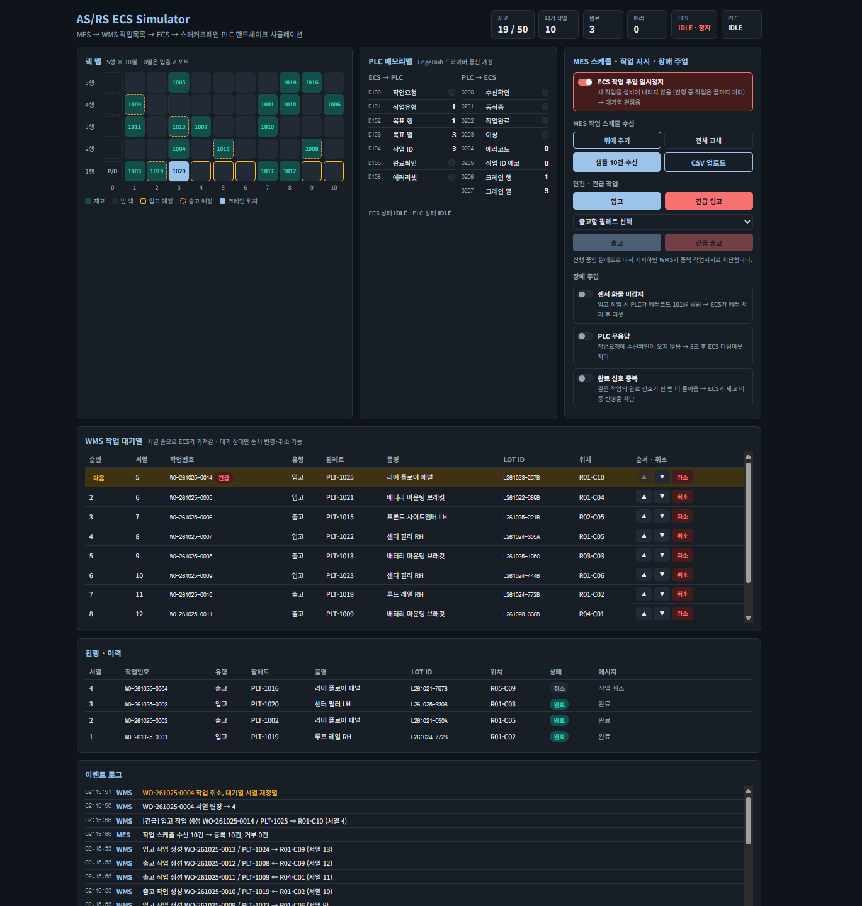
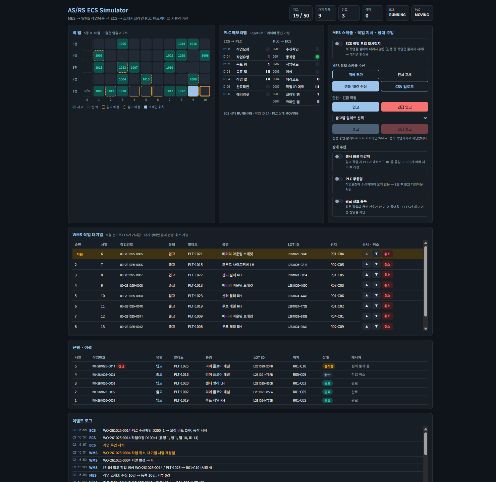
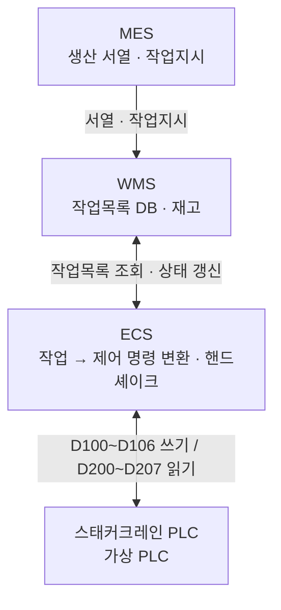
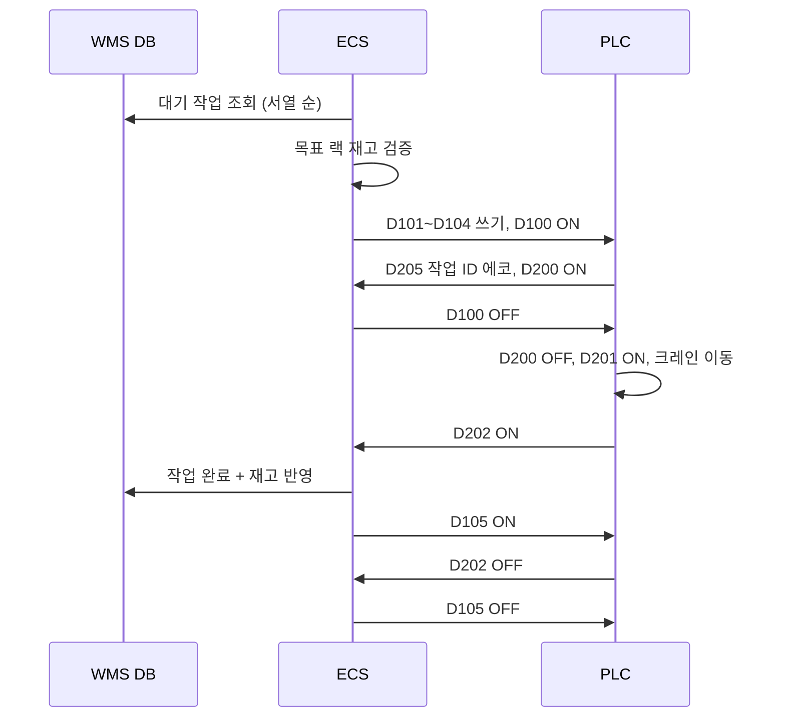

# AS/RS ECS Simulator

자동창고(AS/RS)에서 **MES 작업 스케줄 → WMS 작업 대기열 → ECS → 스태커크레인 PLC** 로 이어지는 흐름을 재현한 시뮬레이터입니다. WMS 대기열 관리(스케줄 일괄 수신, 긴급 삽입, 서열 변경, 취소)와 ECS–PLC 핸드셰이크, 현장 장애 시나리오를 다룹니다.

현대자동차 울산 EV 차체라인 자동창고 구축 프로젝트에서 ECS 단을 담당하며 겪은 구조와 시운전 이슈를 바탕으로, 같은 흐름을 Spring Boot와 React로 다시 구현했습니다. 실제 고객사 코드나 데이터는 포함하지 않았고, 데이터는 모두 가짜 데이터입니다.

> 생성형 AI(Claude)를 활용해 구현했습니다. 시스템 구조, 메모리맵 구성, 장애 시나리오는 실제 현장 경험을 기준으로 설계했고, 코드 동작은 직접 검증했습니다.

## 화면

**대기열 편집** — ECS 투입을 일시정지한 상태에서 MES 스케줄 10건 수신, 긴급 입고 삽입(맨 앞, "다음"), 서열 변경, 작업 취소



**실행 중** — 투입 재개 후 긴급 작업이 먼저 내려가고, PLC 메모리맵에 목표 행·열·작업 ID와 동작중(D201) 신호, 크레인 이동이 표시됨



## 시스템 구조



| 구성 | 실제 현장 | 이 프로젝트 |
|---|---|---|
| MES → WMS | MES가 WMS에만 서열·작업지시 전달 | CSV 스케줄 업로드 / 샘플 스케줄 / 단건·긴급 지시 |
| WMS | Node-RED, 별도 서버 | `WmsOrderService` + H2 DB |
| ECS | Node-RED, 별도 서버 | `EcsService` (300ms 주기 상태머신) |
| PLC 통신 | LS ELECTRIC EdgeHub 드라이버 | `VirtualPlc` (200ms 스캔, 메모리맵 시뮬레이션) |

## WMS 작업 대기열 관리

| 기능 | 동작 |
|---|---|
| 스케줄 일괄 수신 | CSV 또는 JSON으로 여러 건을 한 번에 수신. **뒤에 추가** / **전체 교체** 모드. 전체 교체 시 대기 작업만 취소하고 이미 설비에 내려간 작업은 유지 |
| 행 단위 검증 | 재고에 없는 팔레트 출고, 중복 팔레트, 작업유형 오류는 해당 행만 거부하고 사유를 반환 |
| 긴급 삽입 | 긴급 입고·출고는 대기열 맨 앞에 들어가고, 나머지 서열은 자동으로 밀림 |
| 서열 변경 | 대기 작업을 한 칸씩 앞뒤로 이동, 서열 자동 재정렬 |
| 작업 취소 | 대기 상태만 취소 가능(설비에 내려간 작업은 취소 불가), 이력은 `CANCELED`로 남김 |
| ECS 일시정지 | 새 작업 투입만 멈추고 진행 중 작업은 끝까지 처리 → 대기열을 편집할 시간 확보 |

서열 규칙: 대기 작업은 항상 "이미 진행·완료된 작업의 최대 서열 + 1"부터 연속 번호를 갖고, ECS는 서열이 가장 작은 대기 작업부터 가져갑니다.

CSV 형식 (`sample/mes_schedule_sample.csv` 참고, 일부 행은 거부 사유 확인용으로 일부러 잘못 넣음)
```
type,palletNo,itemName,lotId
IN,PLT-2001,프론트 사이드멤버 LH,L261025-101A
OUT,PLT-1003,,
```

## PLC 메모리맵

| ECS → PLC | 의미 | PLC → ECS | 의미 |
|---|---|---|---|
| D100 | 작업요청 비트 | D200 | 수신확인(ACK) 비트 |
| D101 | 작업유형 (1=입고, 2=출고) | D201 | 동작중(BUSY) 비트 |
| D102 | 목표 행 | D202 | 작업완료(DONE) 비트 |
| D103 | 목표 열 | D203 | 이상(ERR) 비트 |
| D104 | 작업 ID | D204 | 에러코드 |
| D105 | 완료확인(DONE_ACK) 비트 | D205 | 작업 ID 에코 |
| D106 | 에러리셋 비트 | D206 / D207 | 크레인 현재 행 / 열 |

## 핸드셰이크 흐름



ECS는 작업 상태(`WAITING → REQUESTED → RUNNING → DONE / ERROR`)를 기준으로 진행하며, 각 단계에서 상대 신호를 확인한 뒤에만 다음 단계로 넘어갑니다.

## 장애 시나리오 (현장 이슈 재현)

| 스위치 | 현장에서 겪은 문제 | 시뮬레이터 동작 |
|---|---|---|
| 완료 신호 중복 | 같은 작업 신호가 두 번 처리되어 실물 1건에 재고 2건 차감 | PLC가 같은 작업 ID로 DONE을 한 번 더 올림 → ECS가 이미 완료된 작업임을 확인하고 재고 반영 없이 신호만 정리 |
| 센서 화물 미감지 | 시스템은 정상인데 센서가 화물을 인식하지 못해 작업 미시작 | 입고 시 PLC가 에러코드 101 → ECS가 작업 에러 처리 후 에러리셋 핸드셰이크 |
| PLC 무응답 | 작업요청을 보냈는데 설비 반응 없음 | 수신확인이 8초간 오지 않으면 ECS가 요청 비트를 내리고 타임아웃 에러 처리 |
| (항상 동작) 중복 작업지시 | 같은 팔레트에 작업이 중복 생성 | WMS가 진행 중 작업이 있는 팔레트의 신규 작업지시를 409로 차단 |

에러 난 작업은 작업목록에서 재시도할 수 있고, 재시도 시 ECS가 명령 전에 재고와 목표 위치를 다시 검증합니다.

## 실행 방법

필요: JDK 17 이상, Node.js 18 이상

**1. 백엔드**
```bash
cd backend
# IntelliJ에서 backend 폴더를 열고 AsrsApplication 실행
# 또는 Maven이 설치되어 있다면
mvn spring-boot:run
```
`http://localhost:8080/api/state` 에서 JSON이 보이면 정상입니다. H2 콘솔: `http://localhost:8080/h2-console` (JDBC URL `jdbc:h2:mem:asrs`)

**2. 프론트엔드**
```bash
cd frontend
npm install
npm run dev
```
`http://localhost:5173` 접속

## API

| Method | Path | 설명 |
|---|---|---|
| GET | `/api/state` | 재고, 작업목록, PLC 메모리맵, ECS 상태, 이벤트 로그 |
| POST | `/api/mes/schedule` | 스케줄 수신 `{ "mode": "append" \| "replace", "items": [{ "type": "IN", "palletNo": "PLT-2001" }] }` |
| POST | `/api/mes/schedule/sample?count=10&mode=append` | 샘플 스케줄 수신 |
| POST | `/api/orders/inbound` | 입고 작업 생성 `{ "urgent": true }` 이면 긴급 삽입 |
| POST | `/api/orders/outbound` | 출고 작업 생성 `{ "palletNo": "PLT-1003", "urgent": false }` |
| POST | `/api/orders/{id}/move?dir=up` | 대기 작업 서열 변경 (up / down) |
| DELETE | `/api/orders/{id}` | 대기 작업 취소 |
| POST | `/api/orders/{id}/retry` | 에러 작업 재시도 (대기열 맨 뒤) |
| POST | `/api/ecs/pause` | ECS 작업 투입 일시정지/재개 `{ "paused": true }` |
| POST | `/api/faults` | 장애 주입 `{ "sensor": true, "noResponse": false, "duplicateDone": true }` |

## 테스트

`backend/src/test/java/.../AsrsScenarioTest.java` — ECS·PLC 스케줄러가 실제로 도는 상태에서 시나리오를 검증합니다.

- 같은 팔레트에 진행 중 작업이 있으면 중복 작업지시 차단
- 긴급 작업은 대기열 맨 앞에 삽입
- 대기 작업 취소 시 큐에서 빠지고 서열이 연속으로 재정렬
- 완료 신호가 중복으로 들어와도 재고는 한 번만 반영

IntelliJ에서 테스트 파일을 열고 클래스 옆 ▶로 실행하거나, `mvn test`

## 구조

```
backend/src/main/java/com/hyeongseon/asrs
├── domain       Location(랙), WorkOrder(작업목록), EventLog
├── repository   Spring Data JPA
├── service      WmsOrderService(스케줄 수신·대기열 관리·중복 차단), EventLogService, SampleData(가짜 데이터)
├── ecs          EcsService (WMS ↔ PLC 핸드셰이크 상태머신)
├── plc          VirtualPlc (메모리맵·크레인 이동·장애 주입)
├── api          AsrsController
└── config       DataInitializer (5x10 랙, 초기 재고 18건)

frontend/src
└── App.jsx      랙 맵, PLC 메모리맵, 스케줄 수신·작업 지시·장애 주입, 작업 대기열, 이력, 이벤트 로그

sample/mes_schedule_sample.csv   MES 스케줄 업로드 예시
```

## 기술 스택

Java 17 · Spring Boot 3.3 · Spring Data JPA · H2 · React 18 · Vite
